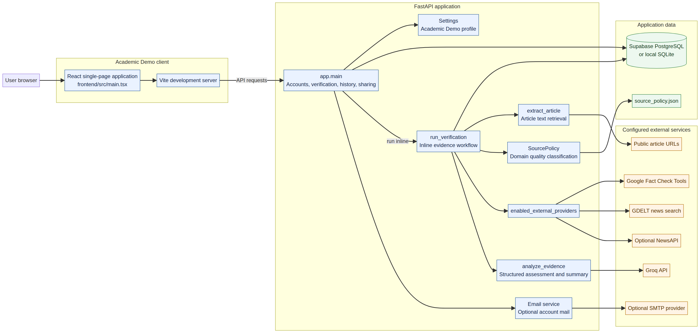
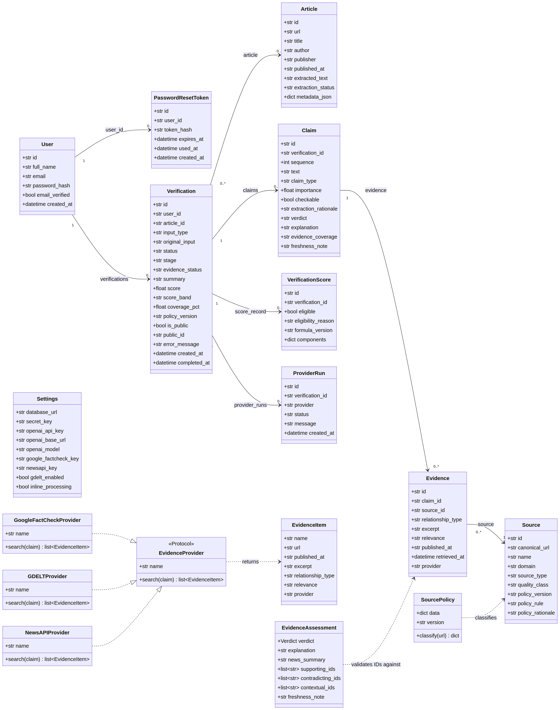

# VeriFact — Final Software Development Project Report

**Prepared by:** System Owner  
**Student:** [Insert student name]  
**Student number:** [Insert student number]  
**Department:** Computer Science & Information Technology, Sol Plaatje University  
**Course:** Project (NPRJ740)  
**Lecturer:** Dr Silas Verkijika  
**Submission date:** 30 October 2026

> This report describes the current VeriFact system in the connected project repository. Personal submission details should be completed by the student. No system capability is described as live-verified unless evidence is explicitly identified.

## Executive Summary

VeriFact is a web-based, evidence-oriented claim-verification system. It helps a signed-in user examine a factual claim or public article URL by collecting source records, showing their excerpts and provenance, applying a versioned domain classification policy, and presenting a bounded assessment. When configured, a Groq-hosted structured language model can assess only the evidence packet retained by the backend. The system computes an overall score deterministically only when its evidence-coverage and source-policy eligibility rules are satisfied. Otherwise it deliberately reports “Insufficient evidence — no overall score”; it does not treat missing information as a zero score or as proof of truth or falsity.

The browser application is built with React, TypeScript and Vite. The API is implemented with FastAPI and SQLAlchemy. PostgreSQL is the intended shared persistent store (including Supabase-hosted PostgreSQL for the academic profile); SQLite is supported for a single-machine trial. Alembic manages schema changes. The repository also contains Docker Compose profiles for local fixture development, the academic demonstration, and production deployment. External capabilities include Google Fact Check Tools, GDELT, optional NewsAPI, Bing News RSS searches of selected sports outlets, Groq-compatible structured analysis, article extraction, and SMTP email. **Brevo SMTP is configured and working for the forgot-password email flow.** SMTP credentials are server-side configuration and are not included in this report.

The current scope includes account creation, login and logout, email verification, password recovery, text/URL submissions, evidence collection and display, report history and search, conditional scoring, private-by-default reports, explicit public sharing, and report deletion. Source code and repository-authored validation records demonstrate functional and configuration tests. The validation log records 18 passing backend tests and a successful frontend build for its dated run; live provider reachability is not certified by that record. The system is a decision-support tool, not an automated authority on truth.

## 1. Project Context

VeriFact is situated in the digital information-literacy and fact-checking domain. Online readers encounter factual claims and news articles whose supporting evidence can be difficult to locate, compare, and interpret. VeriFact is intended for individual readers, students, and evaluators who want to inspect cited evidence and understand the limits of an assessment. It is a general application domain and academic demonstration, rather than a deployment commissioned by a named external organisation.

The product boundary includes the browser client, the VeriFact API and business services, its relational database, the local source-policy data, and configured external evidence, model, article and email providers. External providers remain independent services: VeriFact requests records from them but does not control their coverage, uptime, ranking or terms. The operator configures credentials and decides which services are enabled.

## 2. Problem, Purpose and Success Criteria

### 2.1 Problem Statement

Readers often face factual claims presented without enough accessible context to judge their evidential basis. Searching manually across publishers and prior fact-checks is time-consuming, and a confident automated answer can obscure the difference between evidence, interpretation and uncertainty. A score without transparent evidence rules can give a false impression of certainty. These problems affect readers and learners who need to evaluate public information responsibly.

VeriFact addresses this problem by keeping the submitted claim, retrieved records, excerpts, source links, source-policy labels, provider outcomes, assessment and score eligibility visible in a single report. The evidence-bound approach is supported by the implementation: the model is instructed not to create sources or IDs, the backend validates model-referenced evidence IDs against the retained packet, source classes are determined from a versioned policy file, and scores are calculated by application code only after eligibility checks. The system’s existing repository documentation and automated tests provide implementation evidence; this report does not claim that interviews or a population study were conducted.

### 2.2 Project Purpose

The purpose of VeriFact is to provide an inspectable workflow for checking factual claims and public article URLs against available evidence, communicating uncertainty, preserving report history for authenticated users, and allowing users to share a report only by explicit action.

### 2.3 Success Criteria

| ID | High-level success criterion | Evidence / evaluation basis |
|---|---|---|
| SC-01 | A user can complete account access and securely recover an account password. | Auth and reset workflow tests; SMTP recovery delivery operation (Brevo) |
| SC-02 | A signed-in user can submit text or an eligible public article URL and obtain a report containing claim and retrieval status. | API/UI workflow tests and report inspection |
| SC-03 | Reports display retained evidence provenance and distinguish supporting, contradicting and contextual records. | Evidence validation tests and report data |
| SC-04 | A score is produced only when defined coverage and source-policy gates are met; otherwise the report remains scoreless with an explanation. | Scoring and insufficient-evidence tests |
| SC-05 | Users’ reports are private by default, ownership is enforced, and public access is enabled only by explicit sharing. | Authorisation and sharing tests |

## 3. Solution Overview and Scope

### 3.1 Solution Overview

A user interacts with VeriFact through a responsive React single-page application. The browser sends same-origin API requests through the development or reverse-proxy configuration to FastAPI. FastAPI authenticates the user, validates the request, stores domain data through SQLAlchemy, and invokes the verification service. In the academic-demo profile, processing occurs inline in the API request. Production configuration includes Redis-backed job infrastructure and a worker. The current demonstration guide describes inline provider processing and does not require a worker to complete the academic demo.

For text input, VeriFact identifies a checkable factual claim and requests relevant records from enabled evidence providers. For article URLs, it retrieves accessible article metadata and text, then attempts to select one central, checkable, headline-aligned claim. If a suitable claim cannot be selected, the report records the extraction result and skips evidence search and scoring. Retained records are normalised into sources and evidence, classified by the local source policy, and passed to the configured structured-analysis provider where available. The backend accepts only valid structured assessments tied to existing evidence IDs. It then computes score eligibility and any score locally, persists the report, and returns it to the interface.

**System context diagram:**



External services represented in the current architecture are Groq’s OpenAI-compatible API, Google Fact Check Tools, GDELT, optional NewsAPI, Bing News RSS for selected sports sources, public article URLs, and SMTP email. Brevo operates as the SMTP provider for password-recovery messages. An external provider failure is recorded as unavailable or partial; it is not converted into invented evidence.

### 3.2 Final Release Scope

Included in the current release:

- User registration, sign-in, sign-out, current-user lookup, email verification and resend flow.
- Forgot-password and reset-password flows using expiring, single-use reset tokens stored as hashes. Brevo SMTP is the working delivery route for forgot-password email; SMTP settings are held on the backend.
- Text/claim and public article URL submission, input validation, verification report creation and status retrieval.
- Live evidence integrations according to backend configuration: Google Fact Check Tools, GDELT, optional NewsAPI, and selected sports outlet search via Bing News RSS.
- Structured claim extraction and evidence analysis through a configured OpenAI-compatible endpoint; the academic-demo example configures Groq and `openai/gpt-oss-20b`.
- Source-domain classification using the versioned `backend/app/fixtures/source_policy.json` policy.
- Evidence-linked claim assessments, provider run records, related-news summary when supported, and deterministic score eligibility/components.
- Dashboard statistics, report history, filtering/search, deletion, and explicit public sharing with public report retrieval.
- PostgreSQL/Supabase persistence, SQLite single-machine trial support, Alembic migrations, environment-based configuration, CI checks, and Docker deployment profiles.

### 3.3 Excluded and Deferred Capabilities

| Capability | Status | Reason / boundary |
|---|---|---|
| Guaranteed verdict for every claim | Excluded by design | Provider coverage and evidence quality vary; unsupported claims remain insufficient-evidence results. |
| Independent universal source-trust ranking | Excluded | The current source policy is explicit and versioned but finite and operator-maintained; classifications are not universal judgments. |
| Automated misinformation takedown or content moderation | Excluded | VeriFact produces reports and does not control publishers or remove content. |
| Native mobile applications | Deferred | Current release is a browser-based React application. |
| Comprehensive multilingual analysis | Deferred | Current structured prompts and interface are primarily English-oriented. |
| Guaranteed exhaustive search of the open web | Excluded | The product is bounded by configured providers, their quotas/indexes and retrieval behavior. |
| User-configurable policy editor or appeals process | Deferred | Policy changes are maintained in the versioned backend data file by system operators. |

### 3.4 Known Limitations and Open Issues

- Provider availability, search indexing, API quotas and network conditions can reduce evidence coverage. Reports expose provider status and do not infer truth from an empty search.
- A score is conditional on at least 60% weighted checkable-claim coverage by default and at least one qualifying High- or Medium-class source among validly assessed evidence. The threshold is configurable. A score is not a probability of truth.
- The source policy recognises a limited set of domains; unmatched domains are Unknown. This does not mean false or inherently untrustworthy, but an Unknown source cannot alone satisfy the qualifying-source gate.
- Public URL extraction depends on the target website’s accessibility and extractable markup. Unsafe or oversized fetches are restricted; blocked or incomplete pages may prevent claim extraction.
- AI analysis depends on the configured service’s schema support, account quota and availability. Invalid, timed-out or ungrounded model output is rejected and results in an explicit analysis limitation.
- The academic-demo guide recommends public, non-sensitive claims because text and source excerpts may be sent to enabled external services.
- The production and local profiles include Redis/worker infrastructure, while the academic-demo profile processes inline. These profiles have different operational behavior and should not be conflated.
- Repository-authored automated tests include mocked external-service behavior; those tests do not establish current live-provider uptime. The validation log specifically says live provider requests were not part of its recorded validation run.
- Email uses the generic SMTP service implementation. Brevo delivery is reported as working for forgot-password by the system owner. The repository’s SMTP configuration examples use placeholders and test email sending with a mocked transport; those tests are not a fresh external Brevo acceptance test.
- Representative screenshots of a running deployed instance were not included in the repository materials reviewed for this report. The UI section therefore documents journeys and references the implemented React interface rather than asserting screenshots were captured.

## 4. System Requirements Specification

### 4.1 Functional Requirements

Priority uses MoSCoW. “Included” means present in the current release scope; it does not imply every external provider is always available.

| ID | Functional requirement | Priority | Release status |
|---|---|---|---|
| FR-01 | VeriFact shall allow a user to create an account with a name, unique email address and valid password. | Must Have | Included |
| FR-02 | VeriFact shall authenticate a registered user and provide sign-out. | Must Have | Included |
| FR-03 | VeriFact shall support email verification and resending a verification message. | Should Have | Included |
| FR-04 | VeriFact shall allow a user to request a password reset and set a new password using a valid, unexpired, unused token. | Must Have | Included; Brevo SMTP delivery working |
| FR-05 | VeriFact shall accept a factual claim/text submission from an authenticated user. | Must Have | Included |
| FR-06 | VeriFact shall accept a public article URL and record extraction/claim-selection results. | Must Have | Included |
| FR-07 | VeriFact shall retrieve evidence using configured providers and record per-provider outcomes. | Must Have | Included; conditional on configuration/availability |
| FR-08 | VeriFact shall retain canonical source details, excerpts, dates, provider attribution and relationship to a claim. | Must Have | Included |
| FR-09 | VeriFact shall apply source classifications from the configured versioned policy rather than model-generated trust labels. | Must Have | Included |
| FR-10 | VeriFact shall assess only retained evidence and reject model citations not present in the evidence packet. | Must Have | Included |
| FR-11 | VeriFact shall calculate a score only when weighted coverage and qualifying-source eligibility rules are met. | Must Have | Included |
| FR-12 | VeriFact shall preserve and display an explicit insufficient-evidence/no-score result when eligibility is not met. | Must Have | Included |
| FR-13 | VeriFact shall allow a user to view, search/filter and delete their own reports. | Must Have | Included |
| FR-14 | VeriFact shall keep reports private by default and permit explicit public sharing and public report retrieval. | Must Have | Included |
| FR-15 | VeriFact shall expose report evidence, score components/eligibility, policy context and provider-run status to the user. | Should Have | Included |

### 4.2 Non-Functional Requirements

| ID | Quality attribute | Requirement | Verification |
|---|---|---|---|
| NFR-01 | Security | Passwords shall be stored using Argon2 password hashing; raw reset tokens shall not be stored. | Security/code review and auth tests |
| NFR-02 | Access control | Private report operations shall require authentication and enforce report ownership; public report access shall require an explicit share state. | API authorisation tests |
| NFR-03 | Session security | Session cookies shall be HttpOnly and signed; production configuration shall require secure cookies and valid secret configuration. | Configuration and security tests |
| NFR-04 | Input safety | Verification input, request size, URL targets, host access, rate limits and CORS origins shall be constrained by configuration and validation. | Validation/security tests and configuration review |
| NFR-05 | Evidence integrity | Source class shall come from source policy; structured model references must correspond to retained evidence IDs. | Unit/integration tests |
| NFR-06 | Reliability | Provider/model failures shall be surfaced as limitations and shall not create fabricated source records, summaries or scores. | Failure-path tests |
| NFR-07 | Persistence | Shared deployment shall use PostgreSQL with Alembic migrations; SQLite is limited to local single-machine trials. | Migration smoke test and database integration tests |
| NFR-08 | Compatibility | The frontend shall build using Node.js 22 and the backend shall run on Python 3.11 or later. | CI build/test workflow |
| NFR-09 | Maintainability | Backend tests, frontend build and delivery configuration checks shall run in CI for the main branch and pull requests. | `.github/workflows/ci.yml` inspection and CI results |
| NFR-10 | Privacy | Claim text and retained excerpts may be sent to enabled external providers; the UI/operator guidance shall warn against submitting sensitive information without reviewing provider terms. | Security documentation review |

### 4.3 Business Rules

| ID | Business rule |
|---|---|
| BR-01 | A user’s verification report is private by default; a public report exists only after the user explicitly enables sharing. |
| BR-02 | A user may access or delete only reports owned by that user unless the report is retrieved through an enabled public identifier. |
| BR-03 | Password-reset tokens are stored as hashes, expire and are single-use; a consumed token cannot reset the password again. |
| BR-04 | For live assessment, the model may interpret only the retained evidence packet and may not create sources, quotations, links, quality labels or evidence IDs. |
| BR-05 | Source quality classes are determined by the current versioned source-policy rules. An unmatched domain is Unknown. |
| BR-06 | A report may be scored only if at least the configured share of weighted checkable claims has valid assessments (default 0.60) and at least one qualifying High- or Medium-class source is attached to validly assessed evidence. |
| BR-07 | An ineligible report has a null score, not a substitute zero, midpoint or model-confidence value. |
| BR-08 | A source appearing in a prior fact-check record supports that record’s reviewed proposition only; the backend/model must treat proposition mismatch as contextual rather than automatically applying its rating to the submitted claim. |
| BR-09 | An article URL is metadata/input for extraction, not itself evidence for the article’s claim. |
| BR-10 | If no headline-aligned, checkable central claim is selected from an article, evidence search and scoring are skipped for that URL submission. |
| BR-11 | Provider failures and zero-result searches are not evidence that a claim is true or false. |

### 4.4 Acceptance Criteria for Included Requirements

- **FR-01–FR-04 — Accounts and recovery:** Required fields are validated; duplicate email is rejected; valid credentials authenticate; invalid credentials do not; a reset request returns a privacy-preserving response; a valid reset link/code updates the password; expired, malformed or reused tokens are rejected. Password reset email is delivered through configured Brevo SMTP in the deployed operational setup. The code-level automated tests mock transport and verify token/message behavior.
- **FR-05 — Text verification:** An authenticated user can submit non-empty valid text; the API creates a report; the resulting report exposes a claim assessment, provider results and evidence status; malformed or oversized input is rejected.
- **FR-06 — URL verification:** A public allowed URL can be submitted; extracted metadata and extraction state are recorded; a headline-aligned factual claim is used when available; a page with no suitable claim receives an uncheckable/insufficient result and no score.
- **FR-07–FR-08 — Evidence retrieval:** Enabled providers are called; result records preserve provider and source metadata; failure/empty-result states are recorded; each retained excerpt links to a canonical source record; unavailable providers do not generate substitute evidence.
- **FR-09–FR-10 — Policy and analysis:** A known domain receives the configured policy class; unmatched domains remain Unknown; invalid structured output or unknown evidence IDs is rejected; only evidence IDs in the retained packet can be referenced.
- **FR-11–FR-12 — Scoring:** An eligible fixture/live assessment returns a score and components; a failed coverage or source-policy condition yields a null score and an explicit reason; no model-generated confidence value is substituted.
- **FR-13–FR-14 — History and sharing:** An owner can list, filter, view and delete their reports; another account cannot access a private report; an unshared report is not publicly retrievable; enabling sharing yields a public identifier; public payload does not expose the owner’s email; sharing can be disabled.
- **FR-15 — Transparency:** A report exposes retained evidence, source class/rationale and provider run statuses; score eligibility reason and component details are available where applicable.

## 5. System Design Specification

### 5.1 Use Cases and Workflows

**Primary actor:** Authenticated user. **Secondary actors:** Unauthenticated visitor (registration/login and public report viewing), SMTP service, evidence providers, configured structured-analysis service, article host, and operator/administrator (deployment and policy configuration; there is no separate administrative UI role in the current frontend).

**Principal use cases:** Register account; verify/resend email; sign in/out; request password reset; submit text claim; submit article URL; view verification status/report; inspect evidence and score rationale; search report history; delete own report; explicitly share/unshare report; view a public shared report.

**Workflow A — Submit claim and inspect evidence:** user enters text → API validates authenticated request and persists a new verification → verification service selects checkable claim → configured providers are queried → provider results are normalised and source policy applied → structured model assesses only retained records (if configured) → IDs are validated → deterministic eligibility/score rules run → report and provider outcomes persist → UI renders assessment/evidence or an explicit insufficient-evidence state. Alternate paths include validation rejection, no evidence, provider unavailable, model unavailable/invalid response, and policy gate failure; each remains explainable and scoreless as applicable.

**Workflow B — Recover password:** user submits an email address → API applies request controls and avoids disclosing account existence → for an eligible account, a random reset token is created and only its hash is stored with expiry → generic SMTP email is sent through Brevo configuration → user opens link or enters the one-time code → API validates token hash, expiry, unused state and password policy → new Argon2 password hash is stored and token is marked used → sign-in succeeds with the new password. Transport failures are surfaced safely by the API; the user can request a new reset. Token content is never persisted as plaintext.

**Workflow C — Submit article URL:** API validates and stores submission → extraction attempts a safe fetch and extracts title/body/publisher metadata → structured extraction selects a central claim aligned to headline → if valid, evidence services search that claim and normal assessment/scoring rules follow → otherwise extraction rationale is stored and search/score are skipped. URL fetch failures and model extraction errors are surfaced as limitations.

**Entity lifecycle — Verification:** `queued` → `running`/stage updates → `completed` with scored or insufficient-evidence outcome; processing may terminate as `failed` with an error message. Inline academic-demo processing may complete during request handling; production includes worker/job services.

**Use case and process diagrams:** Current repository architecture/class diagrams are included in `docs/diagrams/`. The following workflows are specified in prose because no current use-case, activity, sequence or verification-state diagram is checked in with the implementation artifacts reviewed for this report. This is a documentation limitation; diagrams should be added as a future report refinement rather than represented as existing system artifacts.

### 5.2 System Architecture and Technology Stack


| Component | Technology | Responsibility |
|---|---|---|
| Browser client | React, TypeScript, React Router, Vite | Login/account screens, verification submission, dashboard, history, report/evidence display and sharing controls |
| HTTP/API backend | Python 3.11+, FastAPI, Uvicorn, Pydantic | REST endpoints, input validation, authentication, authorisation, health/readiness and error responses |
| Business/data access | SQLAlchemy | Verification processing, provider orchestration, persistence, ownership and data relations |
| Relational database | PostgreSQL 16 (Supabase PostgreSQL supported); SQLite for local single-machine demo | Users, token records, articles, verifications, claims, evidence, sources, score records and provider runs |
| Schema migration | Alembic | Versioned database schema migration and production migration task |
| Job/broker support | Redis 7 and Python worker | Production job/worker support; not required for the inline academic-demo profile |
| Reverse proxy/TLS | Caddy 2.8 | Production HTTPS termination and routing to frontend/API |
| Evidence source policy | Versioned JSON file | Domain-to-source-type and quality classification/rationale |
| Structured analysis | Groq OpenAI-compatible API in academic-demo example; configurable endpoint/model | Article central-claim extraction and evidence-bounded assessment/news summary |
| Evidence retrieval | Google Fact Check Tools, GDELT, optional NewsAPI, Bing News RSS sports path | Discover source records and previously published fact-checks |
| Transactional email | SMTP; Brevo configured for password recovery | Verification and reset email delivery; server-side only |
| CI | GitHub Actions | Backend tests, frontend build, delivery validator, container builds, migration smoke test |

The architecture is a modular Python API deployed as a containerised application, not a collection of independent business microservices. The production Compose topology separates API and worker processes and provides supporting Redis/database/proxy containers, while sharing application code.

### 5.3 Key Architecture and Design Decisions

**Decision 1 — Evidence-gated score instead of model confidence.** Context: fluent model output can appear certain without sufficient evidence. Options: use model confidence; always return a numeric score; or apply explicit eligibility criteria and deterministic calculations. Decision: retain score gates and leave ineligible reports scoreless. Rationale: users see evidence limitations rather than false precision. Consequence: some legitimate claims receive no score when provider coverage is weak.

**Decision 2 — Model output constrained to retained evidence.** Context: generated sources and citations cannot be independently trusted. Options: accept free-text answer/citations; or request a strict structured assessment and validate its evidence IDs. Decision: use Pydantic/schema-constrained outputs, evidence-packet IDs, and backend validation. Rationale: the model interprets evidence but does not control provenance, source classes or score arithmetic. Consequence: provider schema incompatibility can reduce completion, but does not silently produce a fabricated assessment.

**Decision 3 — Relational persistence with explicit domain entities.** Context: reports, claims, sources and evidence have clear ownership and relationships. Options: document store or relational database. Decision: SQLAlchemy relational model with PostgreSQL for shared deployment and Alembic migrations; SQLite remains a local trial option. Rationale: referential integrity and report lifecycle are naturally relational. Consequence: deployments must apply migrations and maintain a compatible database.

**Decision 4 — SMTP abstraction with Brevo delivery.** Context: account recovery requires a reliable email channel without exposing credentials in browser code. Options: browser-side email, custom transport integration per endpoint, or backend SMTP. Decision: generic backend SMTP service with Brevo as configured working provider. Rationale: isolates credentials and supports TLS/authenticated relay. Consequence: delivery requires correct server-side host, port, credentials, sender and network access; integration tests that mock transport do not prove provider uptime.

### 5.4 Application Class Design



The application’s principal persisted classes are `User`, `Verification`, `Article`, `Claim`, `Evidence`, `Source`, `VerificationScore`, `ProviderRun`, `PasswordResetToken` and `EmailVerificationToken`. They model account ownership, submission/report lifecycle, extracted article metadata, claim assessments, source provenance, score eligibility and provider status. SQLAlchemy relationships cascade deletion from a user’s owned reports and from reports to their subordinate claims/evidence/score/provider records as configured.

Service and integration classes/modules include the settings/configuration object; verification orchestration service; safe article extraction service; SMTP email service; job service/worker; `SourcePolicy`; the `EvidenceProvider` protocol and concrete Google Fact Check Tools, GDELT, NewsAPI and Bing sports providers; `EvidenceItem`; and typed `EvidenceAssessment`/`ArticleClaimExtraction` schemas. The class diagram checked into the repository focuses on current principal types and is supplied as an explanatory artifact; implementation modules remain the authority for exact runtime behavior.

### 5.5 User Interface and Interaction Design

The main user is an authenticated reader. The primary journey is sign in → dashboard → “Verify news or a claim” → select pasted text or article URL → submit → inspect report score/no-score, claims, source excerpts and provider runs. Secondary journeys include report history search/filter/delete, explicit share/unshare, account verification, forgot-password, and reset-password.

The public report route displays a shared report without the account email. Account and recovery screens are available before login. Form errors use visible status/alert messages; the interface shows progress while processing and communicates validation or provider failure. No screenshot set was available in the current repository snapshot; this report does not invent or label screenshots as captured evidence. The current interface implementation is `frontend/src/main.tsx` and `frontend/src/styles.css`.

### 5.6 Data Design

VeriFact uses a relational database through SQLAlchemy. PostgreSQL is intended for shared use, with Supabase PostgreSQL accessed directly through the backend connection string; no Supabase service-role key is required by the application. SQLite is supported for single-machine demonstrations. Alembic migrations are under `backend/alembic/versions/`.

**Entity relationships:** User 1—many Verification; User 1—many reset and email-verification tokens; Verification 0/1—Article; Verification 1—many Claim; Claim 1—many Evidence; Evidence many—1 Source; Verification 0/1—VerificationScore; Verification 1—many ProviderRun. Report-owned records are removed through cascading relationships/foreign keys. Source catalog records are shared and are not treated as user-owned report data.

**Data dictionary (key fields):**

| Table/entity | Important attributes | Key/relationship and purpose |
|---|---|---|
| `users` | `id` UUID string, `full_name`, unique `email`, `password_hash`, `email_verified`, `created_at` | Primary account; email unique; Argon2 hash only |
| `password_reset_tokens` | `id`, `user_id`, `token_hash`, `expires_at`, nullable `used_at`, `created_at` | FK to user; hashed one-time reset token lifecycle |
| `email_verification_tokens` | Same token lifecycle fields | FK to user; email ownership verification |
| `articles` | `id`, nullable `url/title/author/publisher/published_at/extracted_text`, `extraction_status`, `metadata_json` | Metadata and extraction result for URL-based report |
| `verifications` | `id`, `user_id`, nullable `article_id`, `input_type`, `original_input`, `status`, `stage`, `evidence_status`, `summary`, nullable `score/score_band/coverage_pct`, `policy_version`, `is_public`, nullable unique `public_id`, `mode`, `error_message`, timestamps | Report aggregate, owner and lifecycle; null score represents ineligibility |
| `claims` | `id`, `verification_id`, `sequence`, `text`, `claim_type`, `importance`, `checkable`, `extraction_rationale`, `verdict`, `explanation`, `evidence_coverage`, `freshness_note` | FK to verification; assessed claim and weighted coverage data |
| `sources` | `id`, unique `canonical_url`, `name`, indexed `domain`, `source_type`, `quality_class`, `policy_version`, `policy_rule`, `policy_rationale` | Shared provenance and applied source-policy record |
| `evidence` | `id`, `claim_id`, `source_id`, `relationship_type`, `excerpt`, `relevance`, nullable `published_at`, `retrieved_at`, `provider`, `fixture` | Links claim to source and records evidence context/lineage |
| `verification_scores` | `id`, unique `verification_id`, `eligible`, `eligibility_reason`, `formula_version`, JSON `components` | One eligibility/calculation record per report |
| `provider_runs` | `id`, `verification_id`, `provider`, `status`, nullable `message`, `created_at` | Provider execution outcome, including partial/unavailable state |

All identifiers are UUID-like strings; timestamps are timezone-aware in application code. Optional values are nullable as indicated. Source policy is versioned JSON rather than a user-editable relational table. Sensitive SMTP/API/database configuration is supplied through environment variables, not stored in public browser code.

## 6. Implementation Specification

### 6.1 Implementation Environment
The complete source code and project documentation are maintained in the GitHub repository `IamFrank-codes/verifact`. The repository is organised by application responsibility:

| Path | Contents and relationship to the architecture |
|---|---|
| `frontend/` | React/TypeScript browser client. `src/main.tsx` implements account screens, submission, report history and report/evidence views; `src/styles.css` contains presentation styles. `package.json` and `package-lock.json` define frontend commands and the locked JavaScript dependency graph. |
| `backend/app/` | FastAPI application and business logic. `main.py` exposes HTTP routes and request lifecycle; `core/` holds settings; `services/` implements verification, URL extraction, email and jobs; `evidence/` contains provider adapters and source policy; `ai/` defines structured model interactions; `models.py`, `schemas.py`, `security.py` and `db.py` implement persistence entities, API validation, authentication utilities and database sessions. |
| `backend/alembic/` | Alembic environment and versioned database migrations, corresponding to relational persistence. `alembic.ini` supplies migration configuration. |
| `backend/tests/` | Pytest unit and API/service integration tests, including mocked external-provider paths and production configuration checks. |
| `docs/` | Final project report, security and scoring rules, setup/validation guides, and checked-in architecture and class diagrams. |
| `ops/` | Production reverse-proxy configuration and PostgreSQL backup/restore utilities. |
| `scripts/` | Demo setup, migration, smoke-test, stack-refresh and delivery-validation utilities. |
| `.github/workflows/` | GitHub Actions CI workflow for automated project checks and build tasks. |

The principal dependency and build/configuration files are `backend/requirements.txt` (Python packages), `frontend/package.json` and `frontend/package-lock.json` (Node packages and scripts), the frontend `vite.config.ts` and TypeScript configuration files, `backend/alembic.ini` (migrations), and the root `docker-compose.yml`, `docker-compose.academic.yml` and `docker-compose.prod.yml` (runtime profiles). Backend and frontend Dockerfiles define their container images. The frontend build runs TypeScript project checks followed by Vite (`npm run build`); backend tests run with pytest. The documented runtime baseline is Python 3.11+ and Node.js 22+.

This structure maps to a modular client/API/data architecture rather than separate business microservices. The React SPA calls the FastAPI API; the API coordinates application services, external providers and structured analysis, while SQLAlchemy persists users, reports and evidence in PostgreSQL (Supabase PostgreSQL is supported) or SQLite for a single-machine demo. In production, Compose additionally separates API and worker processes and provisions Redis, PostgreSQL and Caddy; the Academic Demo processes verification inline. The repository includes the source and build files; this report describes their responsibilities rather than reproducing source code.
### 6.2 Core Modules and Responsibilities
The following mapping covers the Final Release Scope (FR-01–FR-15 in Section 4.1). Each capability is implemented across API, service, persistence and user-interface components; external provider use is conditional on configuration and availability.

| Capability and requirement(s) | Main implementation components | Implementation mechanisms |
|---|---|---|
| Account registration, sign-in/out, email verification and password recovery (FR-01–FR-04) | `main.py` auth routes; `schemas.py`; `security.py`; `services/email.py`; `User`, `PasswordResetToken` and `EmailVerificationToken` models; frontend `Signup`, `Login`, `VerifyEmail`, `Forgot` and `Reset` views | Pydantic validates submitted fields; duplicate emails and invalid credentials are rejected. Passwords use Argon2 hashes, and signed session credentials are carried in HttpOnly cookies. Reset tokens are random, persisted as hashes, expire and are single-use. Forgot-password responses avoid revealing whether an account exists. Verification/reset mail uses backend SMTP configuration (Brevo is configured for reset delivery); transport failure is not treated as successful delivery. |
| Submit text claim or article URL (FR-05–FR-06) | `POST /api/v1/verifications`; `VerificationInput`; `services/verification.py`; `services/extraction.py`; `Article` and `Verification` models; frontend `Verify` view | Authenticated submissions are validated and stored as report records. URL mode accepts public HTTP(S) targets only, rejects local/private/reserved addresses, uses bounded-time requests, restricts content size/type and extracts article metadata/text. Structured extraction selects a checkable claim aligned with the headline; if none can be selected, the report records the limitation and skips evidence search and scoring. |
| Retrieve evidence and retain provenance/provider outcomes (FR-07–FR-08) | `services/verification.py`; `evidence/providers.py` (`GoogleFactCheckProvider`, `GDELTProvider`, optional `NewsAPIProvider`, and selected-outlet Bing RSS provider); `EvidenceItem`; `Source`, `Evidence`, `ProviderRun` models | Enabled adapters normalise results into evidence records retaining canonical URL, provider, excerpt, publication/retrieval dates and claim relationship. Provider outcomes are stored as success, partial or unavailable where applicable. Empty results and exceptions remain explicit limitations and do not create substitute evidence. Google ClaimReview ratings retain the reviewed proposition and are contextual unless relevant to the submitted claim. |
| Apply source classifications and assess only retained evidence (FR-09–FR-10) | `evidence/source_policy.py`; versioned `fixtures/source_policy.json`; `ai/structured.py`; `EvidenceAssessment`; `services/verification.py`; `Source` and `Evidence` models | Source class and rationale are assigned from versioned domain/path policy rules, not model output; unmatched domains use the policy default (Unknown). The model receives the retained evidence packet and returns schema-constrained results. Pydantic validates response shape and the service checks cited evidence IDs against the packet before accepting references. Invalid, unavailable or ungrounded analysis yields a limitation rather than an AI-only conclusion. |
| Calculate eligible scores and preserve no-score outcomes (FR-11–FR-12) | `score_verification()` in `services/verification.py`; `VerificationScore` and `Verification` models; `SCORING_AND_EVIDENCE.md`; frontend `ScoreCard` and score-method details | Score arithmetic and eligibility are deterministic application logic, separate from model interpretation. The service applies weighted claim-coverage and qualifying-source gates (default threshold is documented in Section 4); it stores eligibility reason, formula version and components. If a gate fails, the score remains `null` and the report explains why instead of substituting zero or model confidence. |
| View, search/filter and delete owned reports (FR-13) | `main.py` verification list/detail/status/delete routes; `get_owned()`; `Verification` relationships; frontend `Dashboard`, `History` and `Report` views | Report operations require an authenticated user and resolve records through ownership checks. Search/filter parameters are applied by the API; deletion follows configured relational cascades for report-owned records while shared source records remain shared. API failures use explicit HTTP responses and the common exception handler. |
| Keep reports private by default and enable public sharing explicitly (FR-14) | `main.py` share/update and public-report routes; `ShareInput`; `Verification.is_public` and `public_id`; frontend `Report` share control | New reports are private by default. Only an authenticated owner can change visibility; a public identifier is used for retrieval only after sharing is enabled. Private report routes enforce ownership, and the public response omits owner email. Users can disable sharing. |
| Expose evidence, policy context, score eligibility and provider status (FR-15) | `verification_out()` serialization; `Source`, `Evidence`, `VerificationScore`, `ProviderRun`; frontend `EvidenceList`, `ClaimCard`, `ScoreCard` and `Report` | The report presents source links, excerpts, dates, provider attribution, policy class/rationale/version, claim relationships, score components/reason when available, and provider-run messages. Missing evidence or failed providers are presented as limitations, not as successful assessments. |

Supporting implementation modules include `core/config.py` for environment-backed settings and production checks, `db.py` for database sessions and schema setup, `services/jobs.py` and `worker.py` for the production job path, and `fixtures/` for deterministic local demonstration data and policy configuration. `backend/alembic/` versions database changes. Request-size and security-header middleware, configured CORS/host/rate controls, and the global exception handler in `main.py` provide cross-cutting safeguards and failure responses. Repository tests use mocked external calls where indicated in Section 7.

### 6.3 APIs, Integrations and External Dependencies

**Core API paths observed in source:**

| Method | Path | Purpose |
|---|---|---|
| GET | `/health`, `/ready` | Liveness and readiness information |
| POST | `/api/v1/auth/register` | Create account and attempt verification mail |
| POST | `/api/v1/auth/login`, `/logout` | Authenticate/end session |
| GET | `/api/v1/auth/me` | Current authenticated user |
| POST | `/api/v1/auth/verify-email`, `/resend-verification` | Verify/resend email confirmation |
| POST | `/api/v1/auth/forgot-password`, `/reset-password` | Request reset and apply one-time reset |
| POST | `/api/v1/verifications` | Create verification submission |
| POST | `/api/v1/verifications/{id}/run-fixture` | Run deterministic local fixture path |
| GET | `/api/v1/verifications`, `/{id}`, `/{id}/status` | List/filter/detail/status for owned reports |
| DELETE | `/api/v1/verifications/{id}` | Delete owned report |
| POST/PATCH | `/api/v1/verifications/{id}/share` | Set report visibility |
| GET | `/api/v1/reports/{public_id}` | Retrieve an explicitly public report |

Google Fact Check Tools searches published ClaimReview records. GDELT and optional NewsAPI assist news discovery. Bing News RSS is used with individual domain restrictions for selected sports outlets; final evidence links are checked against the permitted outlet domains. Groq is configured through the OpenAI-compatible API interface in the academic example. The model handles structured claim extraction/interpretation, not source-policy classification or score calculation. Public article URLs are fetched by the backend’s extraction service. SMTP sends transactional email; Brevo SMTP is the configured working provider for forgot-password messages. Provider network/API failures are represented in provider-run status or safe API errors.

### 6.4 AI / Machine-Learning Component

AI is part of the live evidence workflow, but not the scoring engine. The academic-demo configuration uses a Groq endpoint via the OpenAI-compatible Chat Completions API, model `openai/gpt-oss-20b`; settings permit configuring the compatible endpoint/model. For URL submissions, input includes a headline and bounded article text, with output constrained to a central claim, checkability, headline alignment and rationale. For evidence analysis, input includes the submitted claim and retained evidence packet with source, URL, source type/class, publication date, excerpt and evidence identifier. Output is structured into verdict, explanation, short source-bounded summary, supporting/contradicting/contextual IDs and freshness note.

The backend validates response schema and cited IDs. Source labels are assigned from local policy, and the score is calculated in application code. If the model is unavailable, rate-limited, returns malformed output, or cites an unknown ID, VeriFact rejects that analysis; it does not create an AI-only conclusion or score. The model can be uncertain or incomplete, and provider evidence can be biased or missing. Current tests exercise structured behavior using mocked provider responses; no model benchmark or independent accuracy evaluation is claimed in this report.

## 7. Verification and Testing

### 7.1 Test Approach

The repository includes pytest backend suites (`test_mvp.py`, `test_live_evidence.py`, `test_production_config.py`), frontend TypeScript/Vite build verification, static delivery validation, Docker builds and a production database migration smoke test in GitHub Actions. Unit/integration-style tests use local SQLite/TestClient and mock external calls where appropriate. Relevant areas cover account flows, score eligibility, source policy, evidence/model response validation, provider failures, URL claim extraction, public/private reports, SMTP message composition and production settings.

The checked-in validation log records, for its 16 October 2026 run, 18 passing backend tests, a successful frontend build, delivery-profile validation and configuration checks. During the source-policy update on 30 October 2026, the complete backend suite was run in an isolated Python environment: **31 tests passed**. The run included the new publisher-domain and path-scope regression tests. No live external provider request was made; automated checks do not certify external service credentials or availability. The frontend build and production migration workflow were not re-run as part of the source-policy update.

### 7.2 Functional and Business-Rule Verification

| Test ID | Requirement / rule | Scenario | Type | Expected result | Evidence/status |
|---|---|---|---|---|---|
| TC-01 | FR-01, FR-02 | Register account and authenticate | API integration | User is created and can sign in | Test source present; prior logged suite pass |
| TC-02 | FR-04, BR-03 | Request reset, set new password, reuse token | API integration | First reset succeeds; token reuse rejected | Test source present; SMTP mocked in test |
| TC-03 | FR-04 | Compose reset message | Unit | Email contains reset link/manual code | Test source present; transport mocked |
| TC-04 | FR-05, FR-08 | Run deterministic evidence-supported fixture | API integration | Completed report has retained evidence and eligible score | Test source present |
| TC-05 | FR-12, BR-06–07 | Submit fixture with insufficient evidence | API integration | Score remains null and result explains insufficient evidence | Test source present |
| TC-06 | FR-06, BR-10 | URL has no eligible headline-aligned central claim | Service integration | Evidence search/scoring skipped; no score | Test source present |
| TC-07 | FR-09, BR-05 | Classify known and unlisted source domains | Unit | Policy class assigned; unmatched domain remains Unknown | Test source present |
| TC-08 | FR-10 | Model cites ID outside evidence packet | Unit/service | Assessment rejected; no invalid citation accepted | Test source present |
| TC-09 | FR-07, NFR-06 | Provider unavailable or no results | Service integration | Limitation shown; no invented evidence or summary | Test source present |
| TC-10 | FR-14, BR-01–02 | Share private report then access public link | API integration | Explicit share enables report; public data excludes owner email | Test source present |
| TC-11 | NFR-03 | Invalid production secret/cookie/database settings | Config unit | Production configuration rejected | Test source present |
| TC-12 | NFR-07–09 | Apply production migration/build containers | CI integration | Migration and builds complete in CI environment | CI workflow present; external CI run not separately inspected |

**Brevo note:** The owner reports that Brevo SMTP is working for forgot-password email. Source code uses a generic SMTP sender and configured SMTP settings; the checked-in automated mail tests mock the transport. Thus transport behavior is covered, while those tests do not constitute a live Brevo send result.

### 7.3 Non-Functional and Security Verification

Password hashing uses Argon2; session cookies are HttpOnly and signed. Reset tokens are hashed, time-limited and one-use. Ownership checks protect private report routes; public retrieval uses a separate public identifier after user sharing. Configuration includes rate limits, request/input limits, trusted-host and CORS controls, security headers and safe URL extraction. Production settings require PostgreSQL, a sufficiently long secret, secure cookies and appropriate host/origin configuration. Automated tests cover production configuration rejection/acceptance and report visibility. The repository’s security notes warn that submitted text/excerpts may be sent to external providers. Performance, broad browser compatibility, penetration testing, and a formal usability study are not supported by evidence in the checked-in validation log and are not claimed as completed.

### 7.4 Defects and Known Issues

No unresolved release-blocking defect is identified in the repository-authored validation log. The material open limitations affecting included functionality are provider/model availability, finite source-policy coverage, URL extraction variability, external quota/rate-limit dependencies, absence of fresh live-provider acceptance evidence in the recorded validation, and lack of screenshots in the checked-in documentation snapshot. These are also stated in Section 3.4. The current report does not infer that all runtime environment settings or external accounts are healthy from static configuration alone.

## 8. System Setup and Operation

### 8.1 Academic demonstration setup

Requirements: Python 3.11+, Node.js 22+, Git, internet connectivity for enabled providers, and either a Supabase PostgreSQL project or SQLite for a single-machine trial. A Groq API key is required for structured live analysis. Google Fact Check Tools and NewsAPI keys are optional; SMTP configuration is required for real email delivery. Docker Engine and Compose are optional for the included launcher.

From the repository root:

```bash
cp .env.academic-demo.example backend/.env
chmod 600 backend/.env
```

Set a unique `VERIFACT_SECRET_KEY`, a valid `VERIFACT_DATABASE_URL`, Groq key/endpoint/model, and any desired provider keys. The Supabase database password must be URL-encoded where required. For password reset, configure the backend `VERIFACT_SMTP_*` values for the working Brevo SMTP account (host, port 587, username, password, sender address/name, STARTTLS enabled). Never place any secret in frontend variables or source control.

Prepare the backend and database schema:

```bash
cd backend
python3 -m venv .venv
. .venv/bin/activate
pip install -r requirements.txt
alembic upgrade head
```

For SQLite, the application creates its local schema at startup; Alembic is used for the shared PostgreSQL schema. Start the API in one terminal:

```bash
cd backend
. .venv/bin/activate
uvicorn app.main:app --reload --host 127.0.0.1 --port 8000
```

Start the frontend in another terminal:

```bash
cd frontend
npm ci
VITE_API_PROXY_TARGET=http://127.0.0.1:8000 npm run dev -- --host 127.0.0.1
```

Open `http://localhost:5173`; API health is `http://localhost:8000/health`, readiness is `http://localhost:8000/ready`, and interactive API documentation is at `http://localhost:8000/docs`. The repository also offers `./scripts/academic_demo.sh start|stop|restart|status|logs` or the PowerShell equivalent. Academic demo processes evidence inline and returns completed results to the interface.

### 8.2 Production deployment

Use `.env.production.example` as a template for private `.env.production` on the deployment host. Configure DNS, domain/TLS email, HTTPS origins, unique long secrets, strong PostgreSQL and Redis passwords, provider keys and SMTP settings. The production Compose profile includes PostgreSQL, Redis, a migration task, API, worker, built frontend and Caddy reverse proxy. Apply migrations with the documented Compose `ops` profile, then start the production services. The deployment owner must validate `/health` and `/ready`, mail delivery, backups/restoration and provider connectivity in the target environment. No production URL or demo account is supplied by the inspected repository materials; do not use real user data with placeholder credentials.

## 9. Solution Evaluation

| Success criterion | Outcome | Evidence and qualification |
|---|---|---|
| SC-01 — account and password recovery | Achieved for implemented application flow; Brevo delivery reported working | Reset/token tests and owner-reported working Brevo SMTP. Automated transport tests mock the SMTP connection; no fresh live send performed for this report. |
| SC-02 — text and URL submission | Achieved in implemented scope | API/UI source and tests cover text and headline-aligned URL path, including uncheckable URL behavior. |
| SC-03 — evidence provenance and relationships | Achieved in implemented scope | Source/evidence schema and report interface preserve excerpts, links, provider, source policy and evidence relationship. |
| SC-04 — conditional score and explicit no-score | Achieved in implemented scope | Deterministic scoring implementation and tests cover eligible and insufficient-evidence outcomes. |
| SC-05 — privacy, ownership and explicit sharing | Achieved in implemented scope | Private/public report API and tests cover explicit share, public payload and ownership-oriented access patterns. |

This assessment is based on current source and repository-authored tests/validation evidence, not a new live deployment acceptance run. External provider availability, accuracy, performance under load and a formal user study remain outside the evidence available for this report.

## 10. References

FastAPI. (n.d.). *FastAPI documentation*. https://fastapi.tiangolo.com/

Groq. (n.d.). *OpenAI compatibility*. https://console.groq.com/docs/openai

Mailpit. (n.d.). *Mailpit documentation*. https://mailpit.axllent.org/

PostgreSQL Global Development Group. (n.d.). *PostgreSQL documentation*. https://www.postgresql.org/docs/

React. (n.d.). *React documentation*. https://react.dev/

SQLAlchemy. (n.d.). *SQLAlchemy documentation*. https://docs.sqlalchemy.org/

Supabase. (n.d.). *Connect to your database*. https://supabase.com/docs/guides/database/connecting-to-postgres

VeriFact project repository. (2026). *VeriFact source code and project documentation*. https://github.com/IamFrank-codes/verifact

Brevo. (n.d.). *SMTP integration documentation*. https://developers.brevo.com/docs/send-a-transactional-email

## 11. Appendices

### 11.1 Source repository

The current VeriFact repository is available at [https://github.com/IamFrank-codes/verifact](https://github.com/IamFrank-codes/verifact). The repository contains the application code, deployment profiles, tests and supporting technical notes. Access permissions should be confirmed with the course assessor before submission.

### 11.2 Deployed system

No deployed public VeriFact URL or assessment account is specified in the repository documentation inspected for this report. Use the local demonstration instructions in Section 8 unless the system owner supplies a current deployment URL and assessment account separately.

### 11.3 Supporting source documents

- `README.md` — project overview and quick start.
- `docs/academic-demo.md` — academic demonstration setup and operation.
- `docs/SCORING_AND_EVIDENCE.md` — score eligibility, formula and source policy.
- `docs/SECURITY.md` — security and privacy notes.
- `docs/VALIDATION_LOG.md` — recorded automated validation and live acceptance checklist.
- `docs/supabase.md` — shared PostgreSQL/Supabase setup.
- `docs/diagrams/verifact-architecture-diagram.png` and `docs/diagrams/verifact-class-diagram.png` — current architecture and class diagrams.
